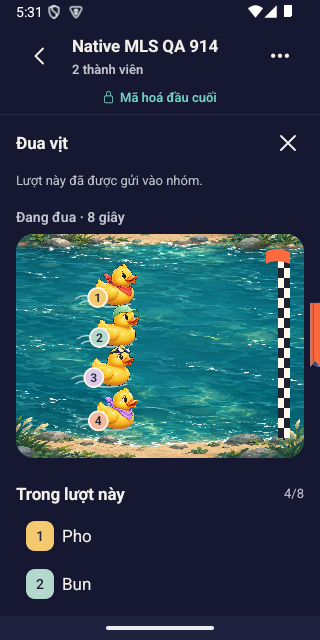
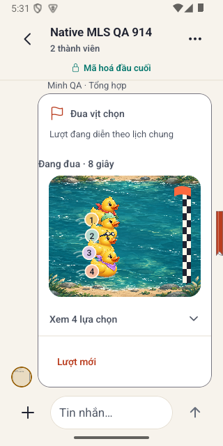
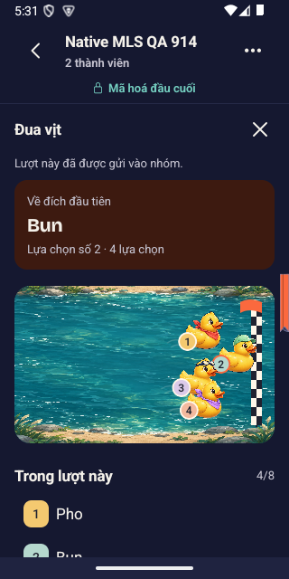
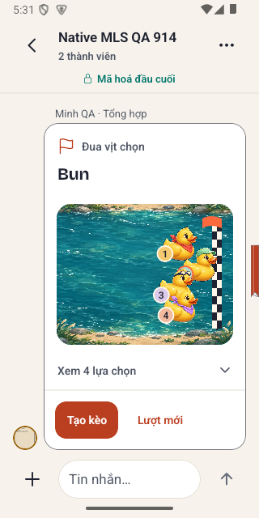

# Bàn giao recovery UI Nếp — 14/10/2026

**Đây là PR bàn giao công việc đang dở, không phải nghiệm thu hoặc triển khai production.** Chủ sản phẩm yêu cầu dừng vòng sửa hiện tại để commit, push một nhánh, tạo PR và chuyển cho agent khác đọc. Không merge `main`, không tiếp tục sửa UI trong lượt đóng gói này.

Nhánh: `codex/nep-ui-recovery-handoff-20261014`. Checkpoint code cuối: `bd3ca28b2864589fd16d714414e3d35baf5bcccf`. Base remote `main` khi đóng gói: `f901f1b41cd21bab0475c8721cdf15dff24c0797`. Trước commit tài liệu bàn giao, nhánh có **165 commit / 503 file thay đổi** so với base. Giữ nguyên lịch sử, không squash hoặc ghi đè công việc khác. [Danh sách toàn bộ commit](./handoff-20261014/COMMITS.md), [file thay đổi](./handoff-20261014/CHANGED-FILES.txt), [số liệu và hash bằng chứng](./handoff-20261014/EVIDENCE.json).

[Draft PR #666](https://github.com/chuoibo/ru-di-app/pull/666) đã tạo, nhánh đã push. Phần code vẫn bd3; các commit bàn giao theo sau chỉ docs/evidence/pin artifact. PR chưa merge hoặc deploy.

## Đọc theo thứ tự

1. Tài liệu này: trạng thái cuối, nợ thật và cách tiếp nhận.
2. [NATIVE-RANDOM](./NATIVE-RANDOM-20261014.md): lát Random mới nhất, cả các lần đỏ và giới hạn bằng chứng.
3. [NATIVE-CHILD-CHAT](./NATIVE-CHILD-CHAT-20261013.md): sticker, bình chọn, tờ hẹn và bàn phím.
4. [RECOVERY](../nep-ui-implementation/RECOVERY-20261008.md) và [NATIVE-UI-QC](../nep-ui-implementation/NATIVE-UI-QC-20261008.md): nhật ký các đợt recovery trước, đọc theo checkpoint ghi trong từng mục.
5. [VISUAL-BLOCK-AUDIT](../nep-ui-implementation/VISUAL-BLOCK-AUDIT-20261012.md), [quality bar native](../nep-ui-implementation/QUALITY-BAR-NATIVE-20261013.md), [coverage route](../nep-ui-implementation/ROUTE-COVERAGE.md) và [layer/action](../nep-ui-implementation/LAYER-ACTION-COVERAGE.md): kế hoạch rà toàn app.
6. [HANDOFF đầu đợt](../nep-ui-implementation/HANDOFF.md), [BLOCKERS](../nep-ui-implementation/BLOCKERS.md), [TEST-RESULTS](../nep-ui-implementation/TEST-RESULTS.md): bằng chứng lịch sử, không phải trạng thái runtime hôm nay.

Khi thông tin mâu thuẫn, ưu tiên checkpoint/date mới có bằng chứng cụ thể. Không sửa hoặc xóa lịch sử đỏ để biến bảng thành xanh. File `BROWSER-PERMISSION-DIAGNOSIS-20261008.md` được nhắc trong hội thoại nhưng **không có trong tracked tree này**; không giả tạo nội dung thay thế. Entry bền trong Git là RECOVERY/NATIVE-UI-QC và tài liệu này. Các path `/tmp` hay thư mục private trong tài liệu cũ không đảm bảo còn tồn tại ở máy khác.

## Yêu cầu sản phẩm phải giữ

- **Audit app thật trong Android emulator**, không dùng bản web app làm bằng chứng thay thế. Browser chỉ được dùng để xem mẫu ngoài như Online Stopwatch.
- Độ đẹp so với mockup là cổng riêng. “Dùng được” hoặc test xanh chưa đạt yêu cầu; chủ động tìm khối thô, bố cục note/list, baseline, lề, spacing và interaction ở mọi scene.
- Frontend theo skill `/impeccable-pipeline`. Skill local đã dùng: `/home/lakiet/.claude/skills/impeccable-pipeline/SKILL.md`; không coi nó là dependency đã được cài trên mọi máy. Đọc craft-floor ngay trước sửa; giữ direction contract ngoài bundle; finish review bằng context mới, rồi documenter.
- Khi cần thay hướng hình ảnh: ImageGen mockup, phản biện rồi code; assets đi kèm phải có prompt/provenance. Không thêm tranh để che bố cục kém. Mockup Random hiện là **reference để critique**, chưa phải comp đã được nghiệm thu.
- Theo dõi host RAM, guest RAM, app PSS/PID và OOM; build/test nặng chạy serial trong scope hữu hạn, tránh đồng thời compiler với emulator. Không chạy load test gây nhiễu audit khác.
- Synthetic fixture only. Không đưa credential, `.env`, khóa MLS, transcript người thật, bill/bank data vào repo hoặc gửi dịch vụ ngoài. Ảnh bàn giao chỉ fixture và chữ kiểm thử.
- Bảo vệ tài nguyên audit trong AGENTS.md; chủ sản phẩm đã chọn “chưa rõ — giữ nguyên”. Không restart Docker/reboot/prune/kill audit. Không sửa money laws, frozen protocol hoặc fallback plaintext.

## Đã làm — theo lát công việc

Các hàng dưới là thay đổi source có thể review. Chỉ phạm vi QC nêu rõ mới có credit runtime; không tự nhận toàn bộ family đã hoàn tất.

| Lát | Source/behavior đã thay | Đọc tiếp và giới hạn |
|---|---|---|
| Hệ Nếp A–S | World giấy/mực/coral, typography, primitive nút/tab/sheet/ảnh/bìa; asset registry và lựa chọn resolution; root/tab/alias/deep-link | DESIGN và `.impeccable/surfaces`; source phủ route không bằng mọi scene runtime pass |
| Welcome/auth/Gu | Bốn trang Welcome; fit minh họa và link màn nhỏ; auth/Gu giữ trạng thái API thật, nhãn đo theo width | Các verdict lịch sử có phạm vi; provider/hardware/final-source mọi auth state chưa đủ |
| Khám phá/địa điểm | Thẻ gọn, ảnh/thông tin có trục; tab Địa điểm/Cộng đồng ở chữ lớn; nhãn tìm kiếm/action cân hàng; detail/gallery giữ state | Card C/D có native lịch sử; toàn bộ filter/map/role/error/long-copy vẫn cần inventory |
| Kèo/map/ngân sách | CTA và form nhường IME; slider ngân sách; calendar/stepper/chặng; marker MapLibre có bounds/ready/cluster/native action | Không tuyên bố GPS/routing thật hoặc mọi map lifecycle đã đạt |
| Nhóm/bạn bè/hai người | Inbox có search và dấu +; tổ chức menu/nhóm/bạn; offer/consent/settings/tờ hẹn theo context | H/I có correction review riêng; mọi quyền/scene cần chạy lại khi source đổi |
| Media/story/avatar/khoảnh khắc | Crop avatar vuông; upload/preview tỉ lệ; story draft/delete; ảnh MLS mở bytes và giữ tỷ lệ; album/wall | Dữ liệu QC tổng hợp; picker/camera/hardware/iOS là cổng riêng |
| Sổ/cá nhân | Bìa/reader/manual diary, nhịp trang; saved diary dẫn Profile; gom menu/sửa hồ sơ và điều khiển | **Khối số liệu Profile vẫn bị bác, còn thô**; không nhận nghiệm thu Profile từ lần đổi chữ hoặc ảnh |
| Bill/quyết toán/tài chính | Receipt, gán món, tiền/label/font reflow, footer và sổ chi; native font module đo SP/width | Integer dong/Σ allocations/version/ledger giữ nguyên; full money vertical/PG/parity không được thay bằng UI test |
| Cộng đồng/composer/comments | Tác giả/audience gọn; rail công cụ gắn submit; body/topic/mention/IME/recovery; giữ nháp/tệp/retry và offset bài | Host behavior và native một số scene có proof; tất cả state/font/device ở code cuối chưa phủ |
| Chat và child sheets | Chat box/nhãn/avatar gọn; legacy read-only; v2 poll; sticker/tờ hẹn; focus reveal và editor không hé history | Không thay đổi Rust ABI hoặc tạo plaintext fallback; ba finding chat nguồn dưới đây chưa sửa |
| Random v1/v2 | Wheel/duck chọn từ snapshot bất biến; CSPRNG native; send ACK trước diễn; retry cùng ID/seed/result; nguồn quán đọc được, replay và Tạo kèo đi đường thật | V1 replay cục bộ; v2 lịch chung chỉ client cập nhật; không chứng thực công bằng/chống gian lận |
| Sân vịt mới | ImageGen river + bốn cutout vịt phụ kiện, đích caro/số gắn vịt/legend; input trước preview; memo interpolation và giữ finish pose | Mới có first batch native bốn vịt; còn overlap/gutter/tải art, chưa beauty pass |
| Go hỗ trợ Random | Lệnh `/random [yêu cầu]`, catalogue read port, producer tách worker; chat/metrics migration v8; ACL clock readonly cùng DB; route ownership | Worker AI positive chưa chạy đạt; không đổi provider hoặc nạp key để che dependency embedding |
| Guest | Go guest/static/amendment presentation và Python oracle tương ứng, giữ parity fixture | Ngoại lệ Python chỉ presentation/regression legacy; các blocker CSRF/no-JS trong hồ sơ cũ chưa được khép bằng checkpoint mới |

### Những sửa mới nhất cần biết

`a084eaac`: hướng sân sông mới, ADR0059, clock readonly, grammar v2 riêng và lịch chung. `d91d5659`: token artwork và raw clock progress. `bd3ca28b`: sửa timestamp event có offset và renewal, preview auto-reveal, giữ finish pose, memo interpolation.

Lỗi bắt trên Android: API/pgx trả event `+07:00` trong khi client chỉ nhận `Z`, làm lượt đã gửi đứng ở vạch xuất phát. Sửa tách event RFC3339 reader khỏi clock UTC; đổi sang epoch **chỉ khi tính**, không viết lại timestamp/body trong sealed log. Probe renewal sau 20 giây giữ anchor cùng reader còn hạn; hạn gốc 30 giây không bị kéo dài khi lỗi; blur/background vô hiệu hóa response cũ.

## Đã kiểm — và kiểm đó không chứng minh gì

| Cổng/nguồn | Kết quả tại checkpoint | Giới hạn |
|---|---|---|
| Exact clean bd3, CHECK độc lập | **9/9**: typecheck, guide, export compile, test compile/fixup, Node subset, Go guide, core build, repo tree guard | Không full CI/strict32/merge-result; export web là compile, không audit browser app |
| Node subset | **1934/1934**, 252 file, fail/skip/cancel/todo 0 | 5 browser và 9 e2e file bị loại theo inventory đã giữ; không nói `npm test` hoặc native toàn app xanh |
| Go guide | **98 test**, 1 package, fail/skip 0 | Không toàn Go suite/PG/parity tại bd3 |
| Focused timing/source | **38/38**, typecheck/compile/fixup pass trước checkpoint | Có overlap với Node full; không cộng thành tổng độc lập |
| Source identity | **1140 blob**, Git/W/CHECK raw **2280** so sánh, 0 mismatch; 43 harness paths đo lại | Chỉ apps/mobile và ba shared/crypto roots, không bao phủ Go/dependencies; harness paths không phải test count |
| Scope build bd3 | Peak khoảng **1,17 GiB**, host available tối thiểu **19,84 GiB** | Fixup/Go-guide telemetry null; không diễn dịch thành zero OOM |
| Go clock tại đợt a084 | HTTP clock unit pass; PG synthetic schema riêng **20/20 test/subtest**, 0 fail/skip sau sửa fixture expiry | Không migration production; lịch sử lượt fixture đỏ vẫn giữ |
| Native bd3 live | Hai actual Android emulator, hai fixture khác nhau, cùng card round ID, dark organizer/light peer, 320×640/font100; cùng racing **12/8/4 giây**, cùng kết quả **Bun** | **Một lượt bốn vịt**; chưa chứng minh mọi nhóm/client/version/network/lifecycle; polling 3 giây có thể nhận muộn, peer không được tính thấy đủ countdown |
| Native preview/IME | Chạm mở preview đưa toàn sân vào viewport; field/caret thật khi gõ Com, footer nhường IME; primary finished-card font200 đã mở (chỉ phần card trong viewport, đầu card/Bun bị cắt ở mép trên ảnh; không fit-pass) | Font200 chỉ ảnh card, chưa đủ Random editor/race/replay. Không có wider/tablet/reduced proof ở code cuối |

Native paired capture có host launch lệch tối đa khoảng **0,235ms**, bracket thu pixel tối đa khoảng **160,272ms**. Đây là giới hạn thao tác ADB trên host, **không đo vsync/frame-lock hay network latency**. Video hai máy đã ghi; root mở tất cả mười timed PNG, không nhận motion benchmark hoặc FPS từ các frame.

Hash/số byte chính xác nằm trong EVIDENCE.json. Bằng chứng lỗi d91 giữ riêng; native bd3 sau sửa supersede lỗi offset tại phạm vi một lượt đã thử. Không lấy việc unit xanh để xóa bằng chứng native trước đó đỏ.

## Ảnh review portable

Ảnh sao chép nguyên bytes, root đã mở. Chỉ dữ liệu tổng hợp; mỗi file pin SHA trong EVIDENCE và repo guard. Không phải shipping artwork, không phải toàn bộ ma trận. Hai ảnh cùng giữa cuộc đua và hai ảnh kết quả cho thấy phạm vi proof.

| Organizer tối | Peer sáng |
|---|---|
|  |  |
|  |  |

[Preview mở trọn sân](./handoff-20261014/screenshots/preview-dark-320.png), [IME thật](./handoff-20261014/screenshots/input-ime-dark-320.png), [card chữ 200%](./handoff-20261014/screenshots/card-dark-font200.png), [Profile còn finding](./handoff-20261014/screenshots/profile-light-open-finding.png).

## Chưa làm / phải làm tiếp

| Ưu tiên | Việc cụ thể | Điều kiện khép |
|---|---|---|
| P0 CI | `check_screens_reachable.py` trên GitHub báo 75/76 màn reachable; `profile/HanhTrinhTeaser.tsx` không có caller sống render | Đọc source/caller và quyết định đúng product; không pin hoặc bỏ gate để giả pass. Chạy lại selftest và reachable gate rồi toàn CI/merge-result |
| P0 | Sân compact vịt/số chồng nhau tại xuất phát và kết thúc | Sửa pitch/height/sprite, xem 2/4/8 lựa chọn ở native, motion và reduced; không thu chữ hệ thống để ép vừa |
| P0 | Card live status lệch gutter và lặp thông tin; initial countdown tải art không đồng bộ, thấy nền phẳng và thiếu hai vịt | Gom status theo cùng trục, chuẩn bị bitmap hữu hạn/atomic stage; không đổi shared schedule hoặc trì hoãn giờ riêng trên mỗi máy |
| P0 | Fresh finish review cho Random chưa trả verdict lưu bền; documenter chưa chạy cho source cuối | Reviewer mới mở đầy đủ ảnh, một batch fixes rồi native recapture/verdict; DESIGN/sidecar cập nhật đúng phạm vi |
| P1 | ProfileFacts còn thô, lề back chat còn cần optical alignment | ImageGen mockup nếu thay hướng; code theo pipeline, không chỉ đổi label; native light/dark/100/200/IME/copy dài |
| P1 | Decoded poll/random kind text có thể nhập vào run text ở `nhip-tin.ts` | Test text→card→text trên projection thật, sửa boundary; native nhóm nhiều dòng và peer |
| P1 | `anh-niem.ts` ảnh 208 + padding/border có thể vượt cột dưới 303dp | Cap theo cột thực; kiểm hẹp/font/tablet; chưa gọi là overflow đã thấy ở320 |
| P1 | Caption ảnh unavailable của tin mình có thể trắng trên nền trắng ở light | Kiểm palette theo nền thật và hồi quy; native peer/own error |
| P1 | `/random [yêu cầu]` tìm quán AI thực tế còn OPEN | Worker/provider embedding hiện thiếu, phải cấu hình đúng riêng rồi chứng minh input→queued→worker→nguồn quán thật trên synthetic QC; capability không bằng delivery |
| P1 | V2 live cần latejoin/resume/offline/retry/duplicate/reopen/reduced/clock-skew trên hai máy | Cùng ID/time/phase/deadline và kết quả; không claim client cũ tương thích, không frame broadcast/fairness |
| P1 | Native cửa sổ390/tablet768, 8 lựa chọn và tên dài, wheel, IME/font200/hot round-trip còn thiếu ở source cuối | Ma trận có ảnh/video thật, giữ draft/ref/session/round; source snapshot trước/sau, memory monitor |
| P2 | Toàn A–S/layer/action và guest/cold/warm/provider/hardware | Đi từng scene, log role/state/action/SHA, tách historical khỏi final; không dựa vào tên file hoặc bảng xanh |
| Trước merge | Full gate/strict32, merge-result, canary đỏ/identity xanh, ít nhất hai mutants tự nghĩ không tương đương cùng harness | Đủ số trong commit message; PG/parity/route ownership/native crypto độc lập đúng sentinel; CI không thay visual |
| Cổng riêng | iOS, thiết bị thật, TalkBack, crypto independent, production deploy | Chưa có bằng chứng; PR này không merge/deploy hoặc ký toàn app SHIP |

Các đề xuất image-loader/peer-stop đã được agent đọc hoặc chuẩn bị private source nhưng **chưa được tính là implementation thêm vào code**. Không lấy một tin nhắn agent “không blocker” làm gate runtime hoặc verdict thẩm mỹ.

## Runtime và evidence khi tiếp nhận

Worktree feature: `/home/lakiet/project/mobile/wt-nep-ui-final-20261006`. CHECK: `/home/lakiet/project/mobile/wt-nep-ui-check-20261008`. Main repo có công việc không liên quan, không reset/stash/clean nó.

Private evidence root: `/home/lakiet/.local/share/rudi-nep-ui/runtime-private-merged-20261006`, ngoài mọi worktree. Không push toàn thư mục đó: chứa cấu hình/auth synthetic và receipts máy. Portable packet trong PR chỉ chọn ảnh tổng hợp và metadata không có credential.

| Packet | Phạm vi |
|---|---|
| `native-audit-bd3ca28b/clean-provenance.json`, `clean-checks.json` | Root seal 9 checks, rehash 18 raw streams và 2280 file/OID |
| `independent-source-bd3ca28b-20261014-r1/` | Graph/proof/inventory độc lập, không semantic hoặc runtime pass |
| `native-audit-bd3ca28b/root-native-screens/`, `root-peer-native-screens/` | Source witness/actor, draft/IME/preview/nhóm; tên file chỉ là locator, phải mở ảnh |
| `native-audit-bd3ca28b/motion-group-four-r1/` | Hai MP4, 10 PNG, receipt/root-inspection, card ID ở hai XML |
| `native-audit-d91d5659/motion-ducks-four-r1/` | Lượt offset lỗi, không race pass |
| `random-core-buildvcs-d91d5659-20261014-r2/`, `owned-core-binary-upgrade-d91d5659-e6c44ad10576/` | ELF Go stamp sạch/full env proof binary-only; không provider/worker deploy |

Runtime kiểm cuối: API UI SHA khác nhau có khai báo: UI bd3, Go core d91 cùng subtree core/root Go workspace; APK native compile cũ có hash đã kiểm và JS bd3 attach thật. Hai emulator 5558/5560 dùng chung Metro8098, API53559; không dùng web app. Không gán API d91 thành API bd3, không gán export iOS thành launch iOS.

**Trước đóng gói, host boot ID đã đổi.** Các owner/watch/PID receipts của boot QC cũ hết hiệu lực; helper planned-stop đã từ chối trước mutation ở boot check. Root xác minh năm original emulator/Metro/core/legacy receipts không còn alive dưới boot mới; không nhận đó là planned stop thành công, không tự restart hệ thống hoặc Docker. Telemetry cuối có nội dung không parse được sau đổi boot, nên không công bố tổng mẫu/PSS/zero-OOM cuối bd3 từ nó. Memory số d91 trong NATIVE-RANDOM vẫn chỉ phạm vi d91; không chuyển sang bd3.

Agent mới phải preflight boot/ports/process/container ownership trước vận hành. **Không replay launcher, adoption hoặc stop cũ dựa vào PID trong tài liệu.** Đối chiếu script/hash/source/receipt bằng bytes, tạo phase mới có monitor, threshold host và guest hữu hạn; giữ protected audit. Trong đợt đang code/build, emulator OFF theo scheduler; không nới floor để cố ép chạy.

## Cách bắt đầu vòng tiếp

1. Đọc AGENTS/ADR0058/0059, tài liệu này, brief Random và quality bar; xác nhận nhánh/HEAD và runtime mới mà không ghi dữ liệu thật vào repo.
2. Đọc ảnh trong PR và packet private còn hợp lệ; tạo finding list riêng, không coi output agent hoặc portable screenshots là toàn bộ acceptance.
3. Sửa một batch sân compact/status/bitmap, cùng test meaningful; không đổi immutable draw hoặc tự random lại khi lỗi/replay.
4. Bounded source gates → checkpoint sạch → source witness trên actual Android → native batch đủ viewports/fonts/theme/motion/lifecycle; theo dõi RAM/PSS/PID/OOM.
5. Fresh Impeccable reviewer/verdict + documenter, ghi rõ finding resolved/partial/unresolved. Sau đó tiếp Profile/chat và từng scene A–S; không đóng toàn bộ backlog vì Random đẹp hơn.
6. Trước landing `main`, hoàn tất các gate/limitations kể trên hoặc để PR draft và ghi blocker thật. Chủ sản phẩm quyết định nghiệm thu; không tự merge PR bàn giao.

Agent tiếp nhận được yêu cầu đọc và phản biện bàn giao, không được suy từ PR đã tạo rằng toàn app đạt hoặc source đã deploy. Báo lại ba phần: đã hiểu phạm vi, thiếu/sai bằng chứng, bước thực thi đầu tiên. PR và trạng thái CI hiện tại là thông tin ngoài repo; kiểm trực tiếp GitHub khi tiếp nhận.

## Agent khác đã đọc bàn giao

Agent độc lập `nep_ui_pr_handoff_reader` đã đọc tài liệu, ADR/coverage liên quan và mở đủ tám ảnh portable. Kết luận: đủ thông tin để tiếp nhận công việc đang dở; không thấy lỗi tài liệu nghiêm trọng cản Draft PR. Hai đề nghị đã bổ sung: nêu rõ ảnh card font200 bị cắt đầu ở viewport và đặt pointer bàn giao mới ở hai coverage lịch sử. Đây là review khả năng bàn giao, không phải kiểm lại 503 file, chạy gate/native hoặc ký verdict beauty.

Agent xác nhận bước đầu là phase/preflight boot/ownership/RAM mới, không replay stale helper; sau đó batch geometry/status/bitmap, native recapture và fresh finish review. Bản đọc private nằm ngoài repo ở `handoff-reader-20261014-r1/REVIEW.md` dưới evidence root. Metadata PR được root kiểm riêng sau khi tạo; không tự coi PR draft là quyền merge/deploy.

Agent đã đọc readonly metadata/body PR #666 ở head `c5610c17`: Draft, base main, nhánh/SHA khớp, nội dung nhất quán với bàn giao. Root kiểm remote ref đúng cùng SHA. GitHub ghi MERGEABLE nhưng UNSTABLE, không phải gate xanh.

Snapshot CI đầu tại head đó: job [every screen is rendered by something](https://github.com/chuoibo/ru-di-app/pull/666/checks) **FAILURE**. Root đọc log job đã hoàn tất qua API: selftest các canary đỏ/xanh đạt; gate thật báo 75/76, chỉ `apps/mobile/src/rudi/screens/profile/HanhTrinhTeaser.tsx` không render. Ruff/shared money đã SUCCESS, Milvus SKIPPED, nhiều job còn chạy lúc ghi. Đây là blocker giao tiếp cho agent tiếp, không sửa product code trong lượt đóng gói và không tuyên bố kết quả toàn run. Kiểm tab Checks của PR để lấy trạng thái mới; số source gate clean9 trước đó không bao gồm screen reachability này.

Snapshot kế tiếp tại cùng head còn thấy các job đỏ: repo-guard commit-range (số byte export ở commit docs c3, dù current-tree c561 đã sửa), client headers, Go front door/route ownership và API image. Log Go cho `TestTheMeasuredPythonContract` báo CSS actual length 11318 khác measured fixture 10534, cùng các range/header cases; log core image từ chối start khi không kết nối được DB để establish legacy chat guard. Đây là bằng chứng failure, chưa kết luận chỉ cần đổi golden hoặc tắt guard. Client headers báo một chỗ MÙ ở GroupChatLive khi gặp command text `/random ${randomDraft.request}`; đây chưa phải kết luận thiếu X-Actor-ID, cần phân biệt command body với URL và sửa đúng caller/scanner contract; CI còn chạy nên danh sách này không phải final full run. Agent tiếp nhận phải xử lý cả commit-range và runtime/contract, không chỉ reachable; không nới scanner/test/legacy guard để ép xanh.
